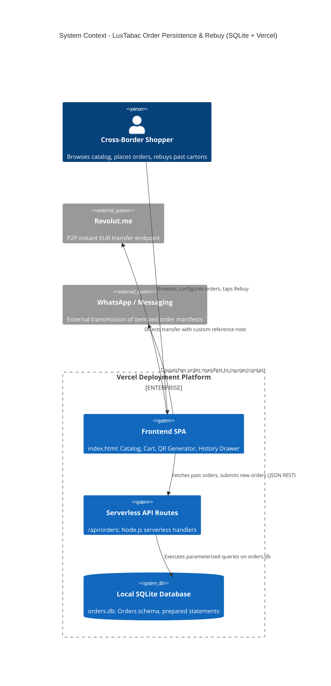

# 001-order-persistence-and-history - System Context

## System Overview
LuxTabac Reserve is a fullstack web application deployed on Vercel, combining an offline-capable client-side interface (`index.html`) with lightweight serverless Node API routes (`/api/orders`) and a local SQLite database for persistent order management, one-click rebuy, and EU cross-border threshold tracking.

## Context Diagram

## Actors & Components

- **Cross-Border Shopper** (Primary Human Actor): Interacts with order builder, reviews historical orders, monitors EU 800-cig guidelines, and taps 1-click rebuy.
- **Frontend SPA** (`index.html`): Responsive client interface communicating with `/api/orders` via `fetch()`.
- **Serverless API Routes** (`/api/orders.js`): Node.js handlers on Vercel routing HTTP requests to the local SQLite database.
- **Local SQLite DB** (`orders.db`): File-backed relational database storing orders with prepared statements.
- **Revolut.me** (Payment Target): Handles EUR peer-to-peer payments initiated by the generated QR code or link.
- **WhatsApp Web / App** (Direct Dispatch): External transport for sharing itemized delivery details directly with the seller.

## High-Level Constraints

- **Vercel Hosting**: Configured via `vercel.json` for static asset serving and serverless function routing.
- **Local SQLite Storage**: Uses embedded SQLite database with automatic schema initialization.
- **Defensive Sanitization**: Output escaping via `escapeHTML()` and parameterized SQL inputs.
