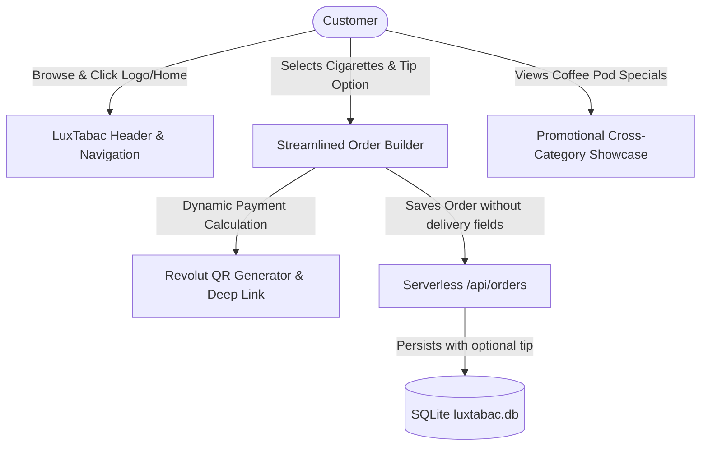

# 002-checkout-refinement-and-promotions - System Context

## System Overview

LuxTabac Reserve operates as an ultra-fast, luxury web-based catalog and Revolut payment companion for cross-border Luxembourg tobacco shoppers. Intent 002 refines the checkout workflow by stripping friction points (delivery date and delivery notes), providing instant Home/Reset navigation in the header, introducing dynamic tip selector chips (`[No tip]`, `[Round to 5€]`, `[Round to 10€]`, `[5%]`), and presenting a promotional showcase for non-tobacco tax-advantaged goods (such as European coffee pods).

## Context Diagram

## External Integrations

- **Revolut Pay**: Direct URI protocol (`revolut://pay/...`) and HTTPS fallback with dynamic tip-augmented total.
- **ISO/IEC 18004 QR Generator**: Embedded SVG renderer updated in real time with tip-adjusted payment link.
- **SQLite Engine**: Node native `node:sqlite` database schema supporting optional delivery notes and tip storage.

## High-Level Constraints

- **Age Verification Integrity**: Clicking Home/Reset must never drop verified `sessionStorage` or re-prompt the 18+ modal.
- **Pure JavaScript & Tailored CSS**: Vanilla DOM reactivity ensuring zero lag (<16ms) during real-time tip calculations.
- **Strict Backward Compatibility**: Orders previously stored with delivery date/notes in SQLite remain valid and viewable in History.
